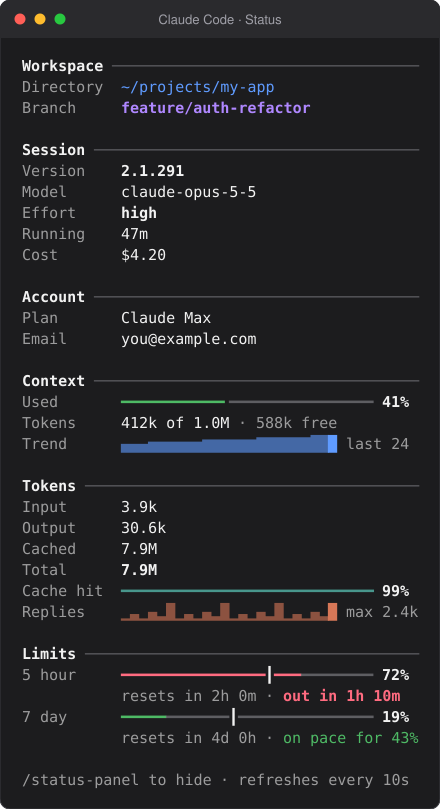

<div align="center">

# status-panel

**Everything the status line can't fit, in a side pane you toggle.**

A [Claude Code](https://code.claude.com) mod that shows your session, workspace, account and usage at a glance, with meters and sparklines drawn in your theme's colours.

[](https://github.com/hcaw/claude-status-panel/actions/workflows/ci.yml)
[](LICENSE)


<picture>
  <source media="(prefers-color-scheme: light)" srcset="docs/pane-light.svg">
  
</picture>

</div>

## Why

A status line is one row, so every figure you add crowds out another. `status-panel` moves the detail into a pane beside the chat that you open when you want it and close when you don't, so your status line can stay small.

## What it shows

| Section | What's in it |
| --- | --- |
| **Workspace** | Directory and git branch |
| **Session** | Claude Code version, model, effort, time running, cost |
| **Account** | Plan and email |
| **Context** | A meter of the context window used, tokens used and free, and a sparkline of how it filled, reply by reply |
| **Tokens** | Input, output, cached and total tokens, a meter of how much input came from the cache, and a sparkline of tokens written per reply |
| **Limits** | A meter for the 5-hour and 7-day windows with a tick where the time elapsed stands, so usage running ahead of the clock shows at a glance |

Each limit is coloured by its outlook, with when it resets and a projection: *on pace for 43%*, or *out in 1h 10m* when you would run out first.

The charts are thin lines and block characters in your theme's colours, so they need no fonts or images, fit the pane at any width and look right in light and dark themes alike.

## Install

In a Claude Code terminal session:

```
/plugin install status-panel --marketplace hcaw/claude-status-panel
```

Answer `y` to add the marketplace, then pick the user scope.

> [!NOTE]
> Mods are an early access feature of Claude Code, so you need a version that supports them, and the mod API may change between releases.

## Use

- **`/status-panel`** toggles the pane.
- The footer row under the prompt shows a `▢ status` / `▣ status` toggle you can click.
- For a keyboard shortcut, add a command binding to `~/.claude/keybindings.json`:

  ```json
  {
    "context": "Chat",
    "bindings": {
      "ctrl+x s": "command:status-panel"
    }
  }
  ```

The pane refreshes every 10 seconds and after each turn while it is open, and does no work while it is closed. It is only ever opened when you ask, never on its own.

## Privacy

Everything comes from Claude Code itself, so the mod:

- makes no network requests and runs no other programs (no `git`, Python or shell), which is also why it behaves the same on macOS, Linux and Windows;
- reads only local files through Claude Code: the git `HEAD` of your working directory for the branch, Claude Code's own `.claude.json` for your plan and email, and the current session's transcript to restore token totals when you resume;
- stores nothing outside the session.

Your email address is shown in the pane, so close it before sharing your screen if that matters to you.

## Develop

You need [Claude Code](https://code.claude.com) and Node.js 20 or later. TypeScript is a dev dependency, so nothing is installed globally, and the mod has no runtime dependencies: Claude Code loads `hooks/register.tsx` directly, with no build step.

```
npm install          # TypeScript, for type-checking only
npm run typecheck    # tsc -p . against the vendored types in types/claude-code.d.ts
npm test             # claude plugin test .
npm run validate     # claude plugin validate .
claude --plugin-dir .   # a session that loads this working copy and reloads it on save
```

Development works the same on macOS, Linux, Windows and Claude Code cloud sessions: line endings are pinned to LF by `.gitattributes`, paths in the mod are joined with `/`, and CI type-checks, tests and validates on all three operating systems. See [CLAUDE.md](CLAUDE.md) for how the mod is put together.

The images above are rendered from the mod's own drawing of the pane, with sample data, so they show exactly what it draws.

## Licence

[MIT](LICENSE) © Harry Wright
